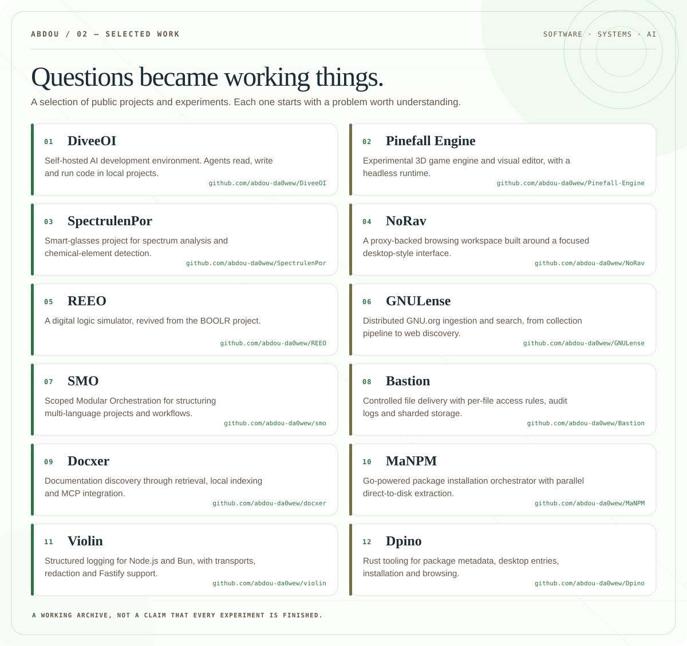
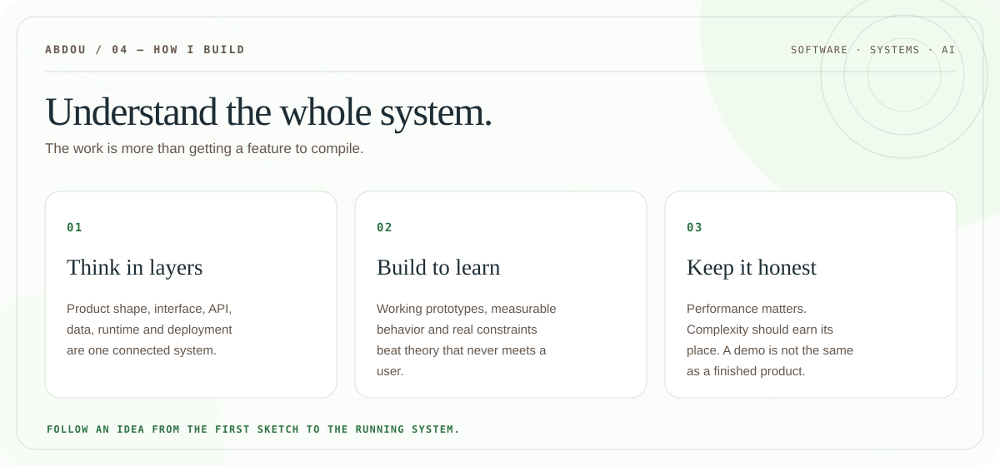
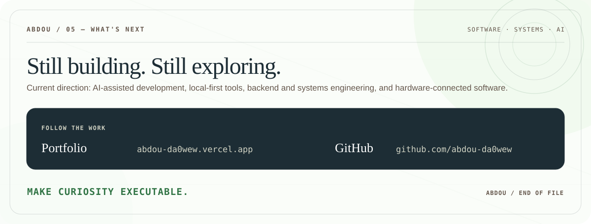

<!--
  This profile is composed entirely of stacked SVG panels.
  The panels share the portfolio's warm-paper / deep-ink / turf-green design language.
  Their ambient background drift uses SVG SMIL so the movement lives inside each image.
-->

  

  

  

  

  

