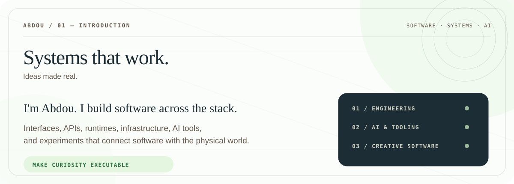
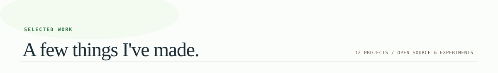
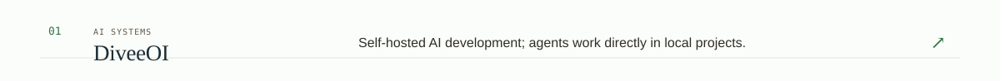
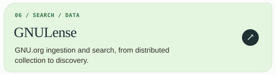
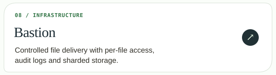
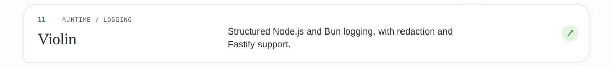
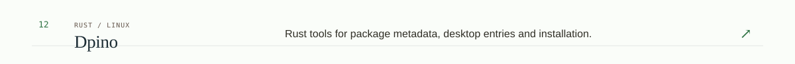
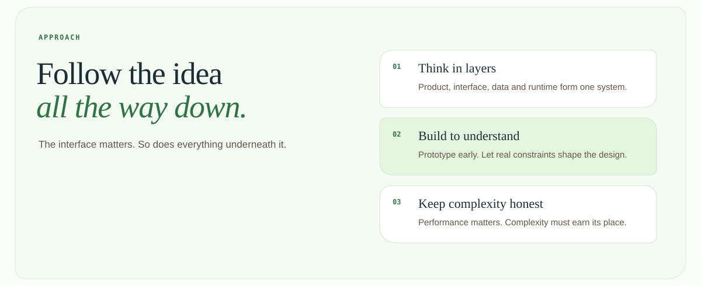
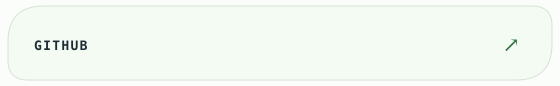

<!--
  A continuous image-led profile in the portfolio's paper / ink / green palette.
  Individual SVG bubbles share one canvas and one restrained background motion.
-->

  

  

  

  

  

  
  &nbsp;
  

