<!--
  Abdou's profile board: one framed composition, shared paper background,
  rounded cards with varied corner shapes, and individually linked projects.
-->

<table width="100%" frame="box" rules="none" border="1" cellpadding="8" cellspacing="0" bordercolor="#D8E2D7">
<tr><td>
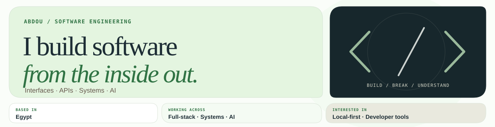
</td></tr>
<tr><td>
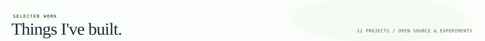
<table width="100%" border="0" cellpadding="4" cellspacing="0"><tr><td width="50%" valign="top"></td><td width="50%" valign="top"></td></tr><tr><td width="50%" valign="top"><a href="https://github.com/abdou-da0wew/SpectrulenPor">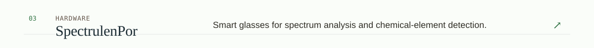</a></td><td width="50%" valign="top"><a href="https://github.com/abdou-da0wew/NoRav">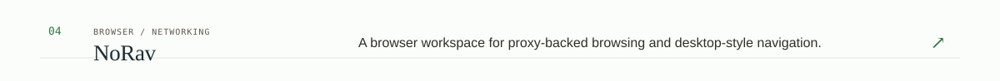</a></td></tr><tr><td width="50%" valign="top"><a href="https://github.com/abdou-da0wew/REEO">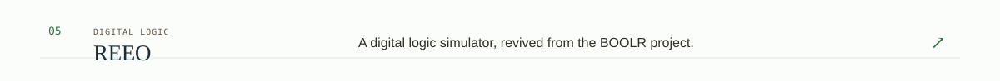</a></td><td width="50%" valign="top"></td></tr><tr><td width="50%" valign="top"><a href="https://github.com/abdou-da0wew/smo">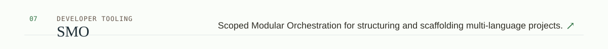</a></td><td width="50%" valign="top"></td></tr><tr><td width="50%" valign="top"><a href="https://github.com/abdou-da0wew/docxer">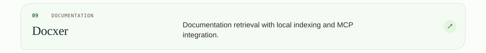</a></td><td width="50%" valign="top"><a href="https://github.com/abdou-da0wew/MaNPM">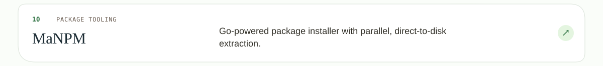</a></td></tr><tr><td width="50%" valign="top"></td><td width="50%" valign="top"></td></tr></table>
</td></tr>
<tr><td>
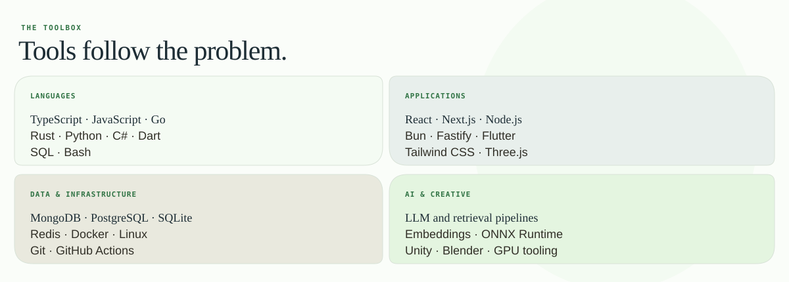
</td></tr>
<tr><td>

</td></tr>
<tr><td>
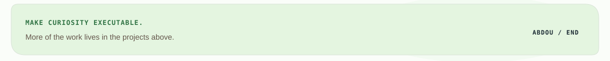
<table width="100%" border="0" cellpadding="4" cellspacing="0"><tr>
<td width="50%"><a href="https://abdou-da0wew.vercel.app">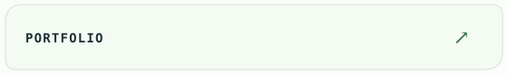</a></td>
<td width="50%"></td>
</tr></table>
</td></tr>
</table>
