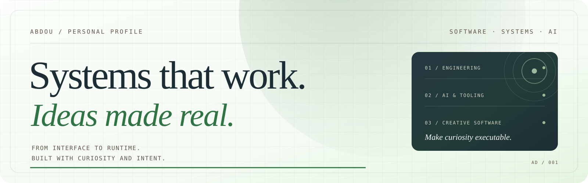

<!--
  Profile README
  Visual direction: warm paper, deep ink, turf green, editorial type.
  Inspired by the portfolio's design system, not copied from its page layout.
-->

  

  <code>SOFTWARE ENGINEERING</code> &nbsp;·&nbsp;
  <code>SYSTEMS</code> &nbsp;·&nbsp;
  <code>AI</code> &nbsp;·&nbsp;
  <code>DEVELOPER TOOLS</code>

  I'm Abdou. I build software across the stack, from interfaces and APIs to runtimes,
  infrastructure, AI-powered tools, and experiments that connect software with the physical world.
  I like understanding how the whole thing works, then making it work better.

  <a href="https://abdou-da0wew.vercel.app">Portfolio</a>
  &nbsp;·&nbsp;
  <a href="https://github.com/abdou-da0wew">GitHub</a>

---

## 01 / Selected work

A few projects that represent the kind of problems I like working on.

| Project | What it is |
|---|---|
| **[DiveeOI](https://github.com/abdou-da0wew/DiveeOI)** | A self-hosted AI development environment. Agents can read, write, and execute code in local projects, with model traffic controlled by the user. |
| **[Pinefall Engine](https://github.com/abdou-da0wew/Pinefall-Engine)** | An experimental 3D game engine and visual editor, built around TypeScript, Three.js, Rapier, React, and Bun. |
| **[SpectrulenPor](https://github.com/abdou-da0wew/SpectrulenPor)** | Smart-glasses project for spectrum analysis and detecting chemical elements and compounds. |
| **[NoRav](https://github.com/abdou-da0wew/NoRav)** | A browser-first proxy workspace, bringing proxy-backed browsing into a focused desktop-style interface. |
| **[REEO](https://github.com/abdou-da0wew/REEO)** | A digital logic simulator, revived from the BOOLR project. |
| **[GNULense](https://github.com/abdou-da0wew/GNULense)** | A large-scale GNU.org ingestion and search pipeline, with distributed collection and a web discovery layer. |
| **[SMO](https://github.com/abdou-da0wew/smo)** | Scoped Modular Orchestration: a toolkit for structuring and scaffolding multi-language projects. |
| **[Bastion](https://github.com/abdou-da0wew/Bastion)** | A controlled file-delivery system with per-file access rules, audit logs, analytics, and a sharded storage layer. |
| **[Docxer](https://github.com/abdou-da0wew/docxer)** | Documentation search tooling built around retrieval, local indexing, and MCP integration. |
| **[MaNPM](https://github.com/abdou-da0wew/MaNPM)** | A Go-powered package installation orchestrator focused on parallel, direct-to-disk extraction. |
| **[Violin](https://github.com/abdou-da0wew/violin)** | A structured logger for Node.js and Bun, with pluggable transports, secret redaction, and a Fastify adapter. |
| **[Dpino](https://github.com/abdou-da0wew/Dpino)** | A Rust utility for package metadata extraction, desktop-entry generation, installation, and browsing. |
| **Triecbot** | A modular Discord automation platform spanning bot services, moderation, community systems, and dashboard tooling. |

## 02 / The toolbox

**Languages:** TypeScript · JavaScript · Go · Rust · Python · C# · Dart · SQL · Bash

**Application development:** React · Next.js · Node.js · Bun · Fastify · Flutter · Tailwind CSS · Three.js

**Data and infrastructure:** MongoDB · PostgreSQL · SQLite · Redis · Docker · Linux · Git · GitHub Actions

I choose tools around the problem. The point is the system that ships, not collecting logos.

## 03 / How I build

- **Think in layers.** Product shape, interface, API, data, runtime, and deployment are one connected system.
- **Build to learn.** I prefer working prototypes, measurable behavior, and real constraints over theory that never meets a user.
- **Keep the details honest.** Performance matters, architecture should earn its complexity, and a demo is not the same thing as a finished product.

## 04 / Current direction

AI-assisted development, local-first tooling, backend and systems engineering, and software that bridges digital interfaces with hardware and real-time experiences.

---

  <strong>Make curiosity executable.</strong>
   
  Designed around the same visual language as my portfolio: warm paper, deep ink, and a little green.

